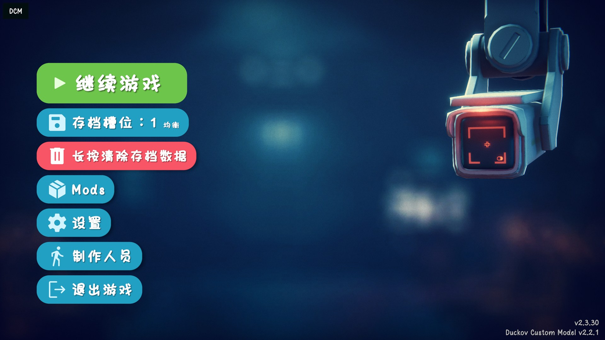
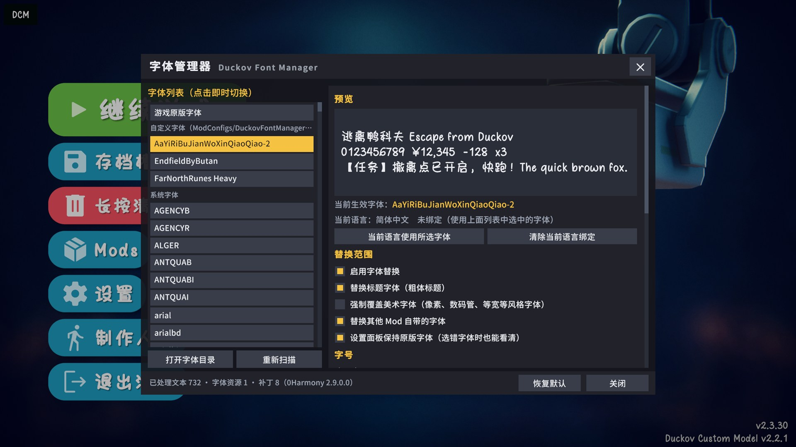
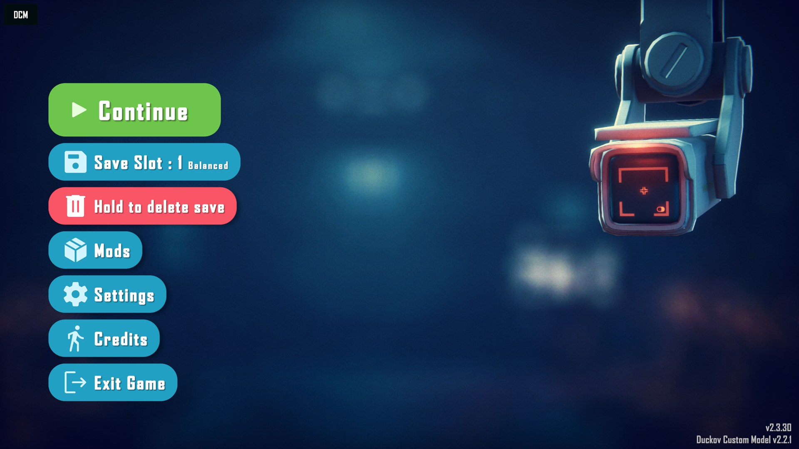

# Duckov Font Manager

逃离鸭科夫（Escape from Duckov）字体管理器 Mod：全局替换字体、调整字号、运行中即时热切换，并提供游戏内设置面板（中文 / English / 日本語 / 한국어）。

**Steam 创意工坊：** <https://steamcommunity.com/sharedfiles/filedetails/?id=3834541127>

> 许愿项目，与 AI（Claude Opus 5.5）协作开发。



| 设置面板 | Agency FB |
|---|---|
|  |  |

## 使用

- 安装：在创意工坊订阅，或把 `release/DuckovFontManager/` 整个文件夹放进 `游戏目录/Duckov_Data/Mods/`，然后在游戏主菜单的 **Mods** 中勾选启用。两种方式不要同时使用。
- 放字体：把 `.ttf` / `.otf` / `.ttc` 文件放进 `游戏目录/ModConfigs/DuckovFontManager/Fonts/`。游戏运行中放入的字体会自动出现在列表里。
- 打开设置：按 **F8**，或在游戏的 **设置** 界面点击 **字体** 标签。
- 美术字体（像素、数码管、等宽等）默认保持原样，可在面板中勾选 **强制覆盖美术字体**。
- 面板支持中文、English、日本語、한국어：默认跟随游戏语言（其他语言显示英文），也可在 **高级 → 界面语言** 中手动指定。
- 新字体缺少的字符（或只有空白字形的字符，比如有些艺术字体的数字）会自动用游戏原字体显示，不会出现方框或消失。
- 配置文件：`ModConfigs/DuckovFontManager/config.json`。排除规则、字体分类关键字、图集参数等高级选项都在这里。
- 本项目不附带任何字体，请遵守你所使用字体的授权协议。

## 构建

需要 .NET SDK（Mod 目标框架 netstandard2.1）。游戏安装路径在 `Directory.Build.props` 中设置，也可以用 `-p:DuckovPath=...` 覆盖。

```bash
powershell -ExecutionPolicy Bypass -File tools/deploy.ps1
```

脚本会编译、复制到游戏的 Mods 目录，并生成只含发布文件的 `release/DuckovFontManager/`。加 `-SkipFonts` 可跳过把 `customfont/` 中的测试字体复制到用户字体目录。

## 发布到创意工坊

`tools/WorkshopUploader` 是独立的上传工具，使用游戏自带的 Steamworks.NET 和 `steam_api64.dll`（编译时从本地游戏目录复制，不随仓库分发）。它会做与游戏内置上传相同的事情，并额外上传多语言标题/描述（`docs/workshop/description.*.txt`）和截图。需要 Steam 正在运行，且登录的账号拥有游戏。

```bash
dotnet build tools/WorkshopUploader -c Release
```

更新已发布的物品（不重复添加截图）：

```bash
tools/WorkshopUploader/bin/Release/net8.0/WorkshopUploader.exe --content release/DuckovFontManager --docs docs/workshop --id 3834541127 --note "更新说明"
```

上传前工具会检查内容文件夹，发现字体文件或 `config.json` 会拒绝上传。

## 结构

| 目录 | 内容 |
|---|---|
| `src/DuckovFontManager/Core` | 总调度（热切换、扫描、热键、语言切换）、字体目录监视、公开 API |
| `src/DuckovFontManager/Fonts` | 字体发现与 TMP 动态字体生成、材质风格迁移、空白字形回退、字号归一化、常用字预热 |
| `src/DuckovFontManager/Text` | 文本登记表、替换规则、应用/恢复 |
| `src/DuckovFontManager/Patches` | TextMeshPro 的 Harmony 后置补丁 |
| `src/DuckovFontManager/UI` | 设置面板、多语言文本、游戏设置界面的“字体”入口 |
| `tools/` | 部署脚本、创意工坊上传工具 |
| `docs/` | 规划与逆向调研、创意工坊描述与截图 |

## 兼容性说明

- Harmony 通过反射调用，运行时绑定到进程中已加载的那一份（Mod 自带的 2.4.1，或 BepInEx 的 HarmonyX 2.9），避免版本不一致导致的 `MissingMethodException`。
- 只使用后置补丁，不跳过原方法，也不修改文本内容；停用时只撤销本 Mod 自己的补丁。
- 其他 Mod 可以给 GameObject 添加 `DuckovFontManager.DfmExclude` 组件，或调用 `DuckovFontManager.FontManagerAPI.Exclude(go)`，让本 Mod 不处理该 GameObject 下的文字。
- 在游戏内停用本 Mod 时会撤销全部补丁，所有文字恢复原状。

## 许可证

本项目以 [Apache License 2.0](LICENSE) 开源，另见 [NOTICE](NOTICE)。

发布包中附带的 Harmony（`0Harmony.dll`）使用 MIT 许可证，见 [THIRD-PARTY-NOTICES.txt](assets/THIRD-PARTY-NOTICES.txt)。
